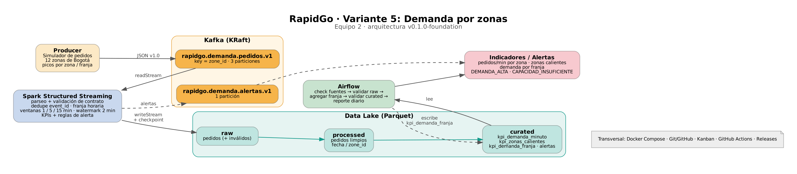

# RapidGo · Variante 5 — Demanda por zonas

Pipeline Big Data end-to-end (Kafka → Spark Structured Streaming → Data Lake → Airflow) para detectar **picos de solicitudes por zona que afectan la disponibilidad y el servicio** de RapidGo.

**Equipo 2** · Línea de Profundización I - Big Data · Ingeniería de Sistemas y Computación, UCundinamarca Facatativá

| Integrante | GitHub | Rol Semana 2 | Rol Semana 3 | Rol Semana 4 |
|---|---|---|---|---|
| Kevin Peña | @tarantis-udec | Kafka / Producer | Airflow | Integración |
| Carlos Guzmán | @anotheruserbtww | Spark / Data Lake | Tests / CI | Release |
| Lizeth Jiménez | @lizeth939993 | Tests / CI | Integración | Calidad / README |

**Estado:** `v0.1.0-foundation` — diseño, contrato y organización.

## Problema de negocio

En horas de almuerzo y cena, o por eventos locales (lluvia, partidos, conciertos), algunas zonas reciben muchos más pedidos de los que sus repartidores pueden atender. Si nadie lo detecta a tiempo, los pedidos esperan sin repartidor, suben los tiempos de entrega y aumentan las cancelaciones.

**Valor de la solución:** medir la demanda por zona minuto a minuto, señalar las zonas calientes y alertar cuando la demanda supera la capacidad, para que operaciones pueda mover repartidores, activar incentivos o ajustar tiempos prometidos antes de que el servicio se degrade.

## Arquitectura



| Componente | Rol en la variante |
|---|---|
| Producer (Python, confluent-kafka) | Simula pedidos en 12 zonas de Bogotá con picos por zona y franja |
| Kafka (KRaft) | Transporta eventos; key `zone_id`, 3 particiones ([ADR-001](docs/decisions/ADR-001-topic-key-particiones.md)) |
| Spark Structured Streaming | Valida, limpia, calcula franja, agrega por ventanas y evalúa alertas |
| Data Lake (Parquet) | Capas raw → processed → curated ([detalle](datalake/README.md)) |
| Airflow | Control batch: calidad → agregación por franja → reporte |
| Docker Compose | Levanta todo el entorno local |
| GitHub (Issues, Kanban, PR, Actions, Releases) | Trazabilidad y CI desde la Semana 2 |

## Kafka

| Topic | Key | Particiones | Uso |
|---|---|---|---|
| `rapidgo.demanda.pedidos.v1` | `zone_id` | 3 | Eventos de pedido (un evento por cambio de estado) |
| `rapidgo.demanda.alertas.v1` | `zone_id` | 1 | Alertas generadas por Spark |

Justificación y evidencia en [ADR-001](docs/decisions/ADR-001-topic-key-particiones.md). Para reproducirla: `python scripts/simular_particiones.py`.

## Contrato del evento

Schema: [`samples/order_event.schema.json`](samples/order_event.schema.json) · Ejemplo: [`samples/order_event.sample.json`](samples/order_event.sample.json) · Ciclo de vida completo: [`samples/order_events.sample.jsonl`](samples/order_events.sample.jsonl)

```json
{
  "event_id": "6f1c2a4e-8b3d-4c7a-9e21-5d0f3b8a7c14",
  "schema_version": "1.0",
  "team_id": "equipo-02",
  "order_id": "ORD-20261022-K7M2QX",
  "zone_id": "BOG-CHA",
  "category": "RESTAURANTE",
  "status": "CREATED",
  "event_ts": "2026-10-22T17:31:05.412Z",
  "active_couriers_in_zone": 184,
  "channel": "APP"
}
```

| Campo | Tipo | Notas |
|---|---|---|
| `event_id` | UUID | Deduplicación en Spark |
| `schema_version` | `"1.0"` | Cambio incompatible ⇒ topic `.v2` |
| `team_id` | `"equipo-02"` | Identifica los eventos del equipo |
| `order_id` | string | Igual en todos los eventos del pedido |
| `zone_id` | enum (12) | Key de Kafka; catálogo en [`config/zonas.yaml`](config/zonas.yaml) |
| `category` | enum | RESTAURANTE, MERCADO, FARMACIA, LICORES, MASCOTAS, OTROS |
| `status` | enum | CREATED, ASSIGNED, PICKED_UP, DELIVERED, CANCELLED |
| `event_ts` | ISO-8601 UTC | Event time para ventanas; la franja se calcula en America/Bogota |
| `active_couriers_in_zone` | int ≥ 0 | Repartidores activos en la zona según despacho; base para la regla de capacidad |
| `channel` | enum, opcional | APP, WEB, CALL_CENTER |

Decisión de diseño: en lugar de un segundo topic de disponibilidad de repartidores, el sistema de despacho adjunta `active_couriers_in_zone` a cada evento. Así la regla de capacidad se calcula con un solo stream, sin joins entre streams.

## KPIs y reglas de alerta

Umbrales en [`config/umbrales.yaml`](config/umbrales.yaml); demanda normal por zona (`baseline_opm`) en [`config/zonas.yaml`](config/zonas.yaml).

### KPIs

| KPI | Cálculo | Ventana |
|---|---|---|
| **Pedidos por minuto (opm) por zona** | `count(status = CREATED)` por `zone_id` | Tumbling 1 min, watermark 2 min |
| **Zonas calientes** | Índice de calor = opm de la ventana / `baseline_opm` de la zona; caliente si ≥ 1.5, más el top 3 por opm | Deslizante 5 min cada 1 min |
| **Demanda por franja** | Pedidos por fecha, franja (madrugada, desayuno, almuerzo, tarde, cena, noche) y zona | Diaria (Airflow) |

### Alertas

| Alerta | Regla | WARNING | CRITICAL |
|---|---|---|---|
| **DEMANDA_ALTA** | Índice de calor en ventana de 5 min (cada 1 min), solo si opm ≥ 3 | ≥ 1.5 | ≥ 2.0 |
| **CAPACIDAD_INSUFICIENTE** | Presión = pedidos CREATED en 15 min / mínimo de `active_couriers_in_zone` en la ventana (cada 5 min) | ≥ 1.0 | ≥ 1.5, o 0 repartidores con pedidos |

### Justificación de los umbrales iniciales

- **Índice de calor 1.5 / 2.0:** se compara cada zona con su propia demanda normal. Un umbral absoluto de pedidos por minuto alertaría siempre en Chapinero (9 opm) y nunca en Ciudad Bolívar (1.5 opm). 1.5× es un pico que ya exige mover repartidores; 2.0× duplica la demanda y compromete los tiempos prometidos.
- **Mínimo de 3 opm:** en zonas de baja demanda, 2 o 3 pedidos sueltos multiplican el índice sin ser un problema real; el mínimo evita falsas alarmas.
- **Presión 1.0 / 1.5:** suponemos que un repartidor completa un ciclo en ~30 min y lleva hasta 2 pedidos, es decir, absorbe ~1 pedido nuevo cada 15 min. Presión 1.0 = la demanda iguala la capacidad; 1.5 = sobra un 50 % de pedidos que quedarán esperando. Los repartidores base de cada zona se dimensionaron para una presión normal de ~0.7, de modo que un pico de 1.5× en demanda lleva la presión a ~1.05 y dispara WARNING en ambas reglas de forma coherente.
- **Ventanas:** 5 min para demanda (reacciona rápido sin ruido de un solo minuto); 15 min para capacidad (coincide con el horizonte de absorción de un repartidor).
- **Watermark 2 min:** tolera eventos que llegan con retraso desde la app móvil sin retener demasiado estado.

Todos son **supuestos de simulación**. En la Semana 2 se compararán con los valores observados en la ejecución y cualquier ajuste se hará por PR con su evidencia.

## Ejecutar localmente (Semana 1)

Prerrequisitos: Docker Desktop (o Docker Engine + Compose v2), Python 3.13, Git.

```bash
git clone <url-del-repo> && cd <repo>
docker compose up -d                       # Kafka + creación de topics + UI
docker compose logs kafka-init             # debe mostrar PartitionCount: 3
# UI de Kafka: http://localhost:8080

python -m venv .venv && source .venv/bin/activate   # Windows: .venv\Scripts\activate
pip install -r requirements.txt
pytest -v                                  # valida contrato y hash de particiones
python scripts/simular_particiones.py      # evidencia del ADR-001
```

## Estructura

```
.github/workflows/   CI (Semana 2)
airflow/dags/        DAG de control (Semana 3)
config/              zonas.yaml, umbrales.yaml
datalake/            raw / processed / curated (+ README)
docs/                arquitectura.png, checkpoints/, decisions/ (ADR)
producer/            simulador de pedidos (Semana 2)
samples/             schema y eventos de ejemplo
scripts/             simulación de particiones, creación de issues
spark/               streaming (Semana 2)
tests/               pruebas de contrato y particiones
```

## Documentación

- [ADR-001 — Topic, key y particiones](docs/decisions/ADR-001-topic-key-particiones.md)
- [Checkpoint Semana 1](docs/checkpoints/semana1.md)

## Releases

| Versión | Contenido | Estado |
|---|---|---|
| v0.1.0-foundation | Arquitectura, contrato, KPIs, alertas, ADR-001, Kanban | ✅ |
| v0.2.0-streaming | Producer, Kafka, Spark, Data Lake, tests, CI | ⏳ |
| v0.3.0-orchestration | Airflow, calidad, fallo controlado, CI ampliado | ⏳ |
| v1.0.0 | Quality gate, README final, video | ⏳ |
