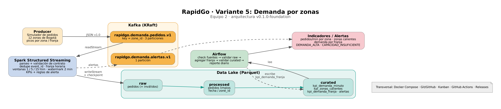

# RapidGo · Variante 5 — Demanda por zonas

Pipeline Big Data end-to-end (Kafka → Spark Structured Streaming → Data Lake → Airflow) para detectar **picos de solicitudes por zona que afectan la disponibilidad y el servicio** de RapidGo.

**Equipo 2** · Línea de Profundización I - Big Data · Ingeniería de Sistemas y Computación, UCundinamarca Facatativá

| Integrante | GitHub | Rol Semana 2 | Rol Semana 3 | Rol Semana 4 |
|---|---|---|---|---|
| Santiago Peña | @tarantis-udec | Kafka / Producer | Airflow | Integración |
| Carlos Guzman | @anotheruserbtww | Spark / Data Lake | Tests / CI | Release |
| Lizeth Jimenez | @lizeth93993 | Tests / CI | Integración | Calidad / README |

**Estado:** `v1.0.0` — pipeline completo Kafka → Spark → Data Lake → Airflow, estabilizado, con CI en cada PR y release publicado solo tras pasar el quality gate.

**Video final:** [ENLACE_VIDEO] · [Guion del video](docs/video/guion.md)

[](https://github.com/lizeth93993/rapidgo-demanda-zonas/actions/workflows/ci.yml)

## Problema de negocio

En horas de almuerzo y cena, o por eventos locales (lluvia, partidos, conciertos), algunas zonas reciben muchos más pedidos de los que sus repartidores pueden atender. Si nadie lo detecta a tiempo, los pedidos esperan sin repartidor, suben los tiempos de entrega y aumentan las cancelaciones.

**Valor de la solución:** medir la demanda por zona minuto a minuto, señalar las zonas calientes y alertar cuando la demanda supera la capacidad, para que operaciones pueda mover repartidores, activar incentivos o ajustar tiempos prometidos antes de que el servicio se degrade.

## Arquitectura



Flujo: el **producer** simula pedidos y los publica en **Kafka** con key `zone_id`; **Spark Structured Streaming** los valida, los agrega por ventanas de tiempo y evalúa las alertas; todo queda en el **Data Lake** en Parquet (raw → processed → curated); **Airflow** revisa cada hora que los datos lleguen y sean confiables, calcula la demanda por franja y genera un reporte.

## Tecnologías

| Tecnología | Versión | Rol en la variante |
|---|---|---|
| Python + confluent-kafka | 3.13 / ≥ 2.6 | Producer: simula pedidos en 12 zonas de Bogotá, con picos por zona y repartidores reducidos ([producer/](producer/README.md)) |
| Apache Kafka (KRaft) | 3.9.1 | Transporta los eventos; key `zone_id`, 3 particiones ([ADR-001](docs/decisions/ADR-001-topic-key-particiones.md), [ADR-002](docs/decisions/ADR-002-ajuste-tras-ejecucion.md)) |
| Spark Structured Streaming | 3.5.6 | Valida, deduplica, calcula franja, agrega por ventanas con watermark y evalúa las alertas ([spark/](spark/README.md)) |
| Parquet (Data Lake local) | — | Capas raw → processed → curated, particionadas por fecha ([datalake/](datalake/README.md)) |
| Apache Airflow | 3.1.8 | DAG horario de calidad, demanda por franja y reporte, con reintentos ([airflow/](airflow/README.md), [ADR-003](docs/decisions/ADR-003-orquestacion-y-recuperacion.md)) |
| pandas + pyarrow | 2.x / ≥ 17 | Leen el Data Lake desde Airflow y desde el verificador del pipeline |
| Docker Compose | v2 | Levanta todo el entorno local con un comando |
| GitHub (Issues, Projects, PR, Actions, Releases) | — | Trazabilidad del trabajo, CI en cada PR y quality gate del release |

## Kafka

| Topic | Key | Particiones | Uso |
|---|---|---|---|
| `rapidgo.demanda.pedidos.v1` | `zone_id` | 3 | Eventos de pedido (un evento por cambio de estado) |
| `rapidgo.demanda.alertas.v1` | `zone_id` | 1 | Alertas generadas por Spark |

Justificación y evidencia en [ADR-001](docs/decisions/ADR-001-topic-key-particiones.md). Para reproducirla: `python scripts/simular_particiones.py`.

## Contrato del evento

Schema: [`samples/order_event.schema.json`](samples/order_event.schema.json) · Ejemplo: [`samples/order_event.sample.json`](samples/order_event.sample.json) · Ciclo de vida completo: [`samples/order_events.sample.jsonl`](samples/order_events.sample.jsonl)

```json
{
  "event_id": "6f1c2a4e-8b3d-4c7a-9e21-5d0f3b8a7c14",
  "schema_version": "1.0",
  "team_id": "equipo-02",
  "order_id": "ORD-20261022-K7M2QX",
  "zone_id": "BOG-CHA",
  "category": "RESTAURANTE",
  "status": "CREATED",
  "event_ts": "2026-10-22T17:31:05.412Z",
  "active_couriers_in_zone": 184,
  "channel": "APP"
}
```

| Campo | Tipo | Notas |
|---|---|---|
| `event_id` | UUID | Deduplicación en Spark |
| `schema_version` | `"1.0"` | Cambio incompatible ⇒ topic `.v2` |
| `team_id` | `"equipo-02"` | Identifica los eventos del equipo |
| `order_id` | string | Igual en todos los eventos del pedido |
| `zone_id` | enum (12) | Key de Kafka; catálogo en [`config/zonas.yaml`](config/zonas.yaml) |
| `category` | enum | RESTAURANTE, MERCADO, FARMACIA, LICORES, MASCOTAS, OTROS |
| `status` | enum | CREATED, ASSIGNED, PICKED_UP, DELIVERED, CANCELLED |
| `event_ts` | ISO-8601 UTC | Event time para ventanas; la franja se calcula en America/Bogota |
| `active_couriers_in_zone` | int ≥ 0 | Repartidores activos en la zona según despacho; base para la regla de capacidad |
| `channel` | enum, opcional | APP, WEB, CALL_CENTER |

Decisión de diseño: en lugar de un segundo topic de disponibilidad de repartidores, el sistema de despacho adjunta `active_couriers_in_zone` a cada evento. Así la regla de capacidad se calcula con un solo stream, sin joins entre streams.

## KPIs y reglas de alerta

Umbrales en [`config/umbrales.yaml`](config/umbrales.yaml); demanda normal por zona (`baseline_opm`) en [`config/zonas.yaml`](config/zonas.yaml).

### KPIs

| KPI | Cálculo | Ventana |
|---|---|---|
| **Pedidos por minuto (opm) por zona** | `count(status = CREATED)` por `zone_id` | Tumbling 1 min, watermark 2 min |
| **Zonas calientes** | Índice de calor = opm de la ventana / `baseline_opm` de la zona; caliente si ≥ 1.5, más el top 3 por opm | Deslizante 5 min cada 1 min |
| **Demanda por franja** | Pedidos por fecha, franja (madrugada, desayuno, almuerzo, tarde, cena, noche) y zona | Diaria (Airflow) |

### Alertas

| Alerta | Regla | WARNING | CRITICAL |
|---|---|---|---|
| **DEMANDA_ALTA** | Índice de calor en ventana de 5 min (cada 1 min), solo si opm ≥ 3 | ≥ 1.5 | ≥ 2.0 |
| **CAPACIDAD_INSUFICIENTE** | Presión = pedidos CREATED en 15 min / mínimo de `active_couriers_in_zone` en la ventana (cada 5 min) | ≥ 1.0 | ≥ 1.5, o 0 repartidores con pedidos |

### Justificación de los umbrales iniciales

- **Índice de calor 1.5 / 2.0:** se compara cada zona con su propia demanda normal. Un umbral absoluto de pedidos por minuto alertaría siempre en Chapinero (9 opm) y nunca en Ciudad Bolívar (1.5 opm). 1.5× es un pico que ya exige mover repartidores; 2.0× duplica la demanda y compromete los tiempos prometidos.
- **Mínimo de 3 opm:** en zonas de baja demanda, 2 o 3 pedidos sueltos multiplican el índice sin ser un problema real; el mínimo evita falsas alarmas.
- **Presión 1.0 / 1.5:** suponemos que un repartidor completa un ciclo en ~30 min y lleva hasta 2 pedidos, es decir, absorbe ~1 pedido nuevo cada 15 min. Presión 1.0 = la demanda iguala la capacidad; 1.5 = sobra un 50 % de pedidos que quedarán esperando. Los repartidores base de cada zona se dimensionaron para una presión normal de ~0.7, de modo que un pico de 1.5× en demanda lleva la presión a ~1.05 y dispara WARNING en ambas reglas de forma coherente.
- **Ventanas:** 5 min para demanda (reacciona rápido sin ruido de un solo minuto); 15 min para capacidad (coincide con el horizonte de absorción de un repartidor).
- **Watermark 2 min:** tolera eventos que llegan con retraso desde la app móvil sin retener demasiado estado.

Todos son **supuestos de simulación**. Con el pipeline real, la tasa de eventos inválidos fue de ~1 % (umbral 5 %) y el pico simulado disparó las dos reglas; ver [Resultados](#resultados).

## Ejecutar el pipeline

Prerrequisitos: Docker Desktop (con al menos 6 GB de memoria asignada), Python 3.13 y Git.

```bash
git clone https://github.com/lizeth93993/rapidgo-demanda-zonas.git && cd rapidgo-demanda-zonas

# 1. Levantar todo: Kafka, topics, Kafka UI, producer, Spark y Airflow
docker compose up -d --build
#    La primera vez tarda: descarga las imágenes y el conector de Kafka para Spark.

# 2. Ver que funciona
docker compose logs -f producer      # [resumen] con mensajes confirmados por partición
docker compose logs -f spark         # [progreso] por query y [ALERTA] cuando se dispara una regla
#    Kafka UI: http://localhost:8080 (topic rapidgo.demanda.pedidos.v1, 3 particiones)

# 3. Provocar un pico en Chapinero y pocos repartidores en Suba
docker compose stop producer
PICO_ZONA=BOG-CHA REDUCIR_ZONA=BOG-SUB docker compose up -d producer
#    El pico empieza en el minuto simulado 5 (30 s reales) y dura 20 (2 min reales).

# 4. Ver la evidencia del Data Lake
docker compose exec spark /opt/spark/bin/spark-submit /app/spark/resumen.py

# 5. Verificar todo el pipeline de punta a punta (Kafka, Data Lake y Airflow)
source .venv/Scripts/activate && pip install -r requirements.txt   # una sola vez
python scripts/verificar_pipeline.py

# 6. Apagar
docker compose down
```

`verificar_pipeline.py` imprime una línea por control (`[OK]`, `[AVISO]` o `[FALLA]`) y termina con código 1 si algo falla. Con `--markdown` imprime una tabla lista para pegar en un PR.

| Variable del producer | Default | Qué hace |
|---|---|---|
| `VELOCIDAD` | 10 | Segundos simulados por segundo real. |
| `PICO_ZONA` / `PICO_FACTOR` | – / 2.5 | Zona con pico de demanda y multiplicador. |
| `REDUCIR_ZONA` | – | Zona que pierde la mitad de sus repartidores durante el pico. |
| `DURACION` | 0 | Segundos reales a ejecutar (0 = sin límite). |

`docker compose down` conserva los mensajes de Kafka (volumen `kafka-data`) y el Data Lake con sus checkpoints, así que al volver a levantar todo continúa donde iba. El producer retoma su reloj simulado desde el último evento del topic.

Para empezar de cero: `docker compose down -v` (borra los volúmenes) y luego borrar el contenido de `datalake/raw`, `datalake/processed`, `datalake/curated`, `datalake/_checkpoints` y `datalake/reports` (sin borrar los `.gitkeep`). Hay que hacer las dos cosas juntas: si se borra solo una, los checkpoints de Spark y Kafka quedan desincronizados.

**Si vienen de `v0.3.0` o anterior, empiecen de cero una vez:** desde `v1.0.0` las alertas se guardan en `curated/alertas/tipo=<TIPO>/` (corrección del Issue #15), y una carpeta con el formato anterior no se puede mezclar con la nueva.

## Airflow: control de calidad y reporte

```bash
docker compose up -d --build airflow     # si no estaba arriba con el resto
```

1. Abrir **http://localhost:8081** (sin usuario ni contraseña; solo para uso local).
2. **Dags** → `rapidgo_control_demanda` → activar el interruptor. Al activarlo corre una vez; después corre cada hora.
3. Para correrlo a mano: botón **Trigger** (▶). Cada tarea muestra su log al hacer clic en su cuadro.
4. El reporte queda en `datalake/reports/ultimo_reporte.md`, y el KPI de demanda por franja en `datalake/curated/kpi_demanda_franja`.

El DAG tiene 6 tareas (`verificar_fuentes → validar_raw → agregar_demanda_franja / resumen_alertas → validar_curated → generar_reporte`), 2 reintentos cada 30 s y pasa métricas por XCom. La estrategia de recuperación está en el [ADR-003](docs/decisions/ADR-003-orquestacion-y-recuperacion.md), y cómo provocar un fallo controlado, en [airflow/README.md](airflow/README.md).

## Pruebas y CI

```bash
python -m venv .venv && source .venv/Scripts/activate   # Mac/Linux: source .venv/bin/activate
pip install -r requirements.txt
pytest -v                                               # contrato, particiones, reglas, producer y calidad
python producer/producer.py --dry-run --max-eventos 20  # producer sin Kafka
```

GitHub Actions (`.github/workflows/ci.yml`) corre en cada push a `main`, en cada Pull Request y manualmente (**Actions → CI RapidGo → Run workflow**), con dos jobs:

- **validar**: compileall, validación de YAML, `pytest` (contrato, particiones, reglas, producer, calidad, verificador y documentación), `docker compose config` y un aviso si la documentación tiene pendientes.
- **Validar DAG de Airflow**: instala Airflow 3.1.8 e importa el DAG (`tests/test_dag.py`: sin errores, al menos 5 tareas, reintentos y dependencias), más las pruebas de calidad.

### Quality gate y release

El release final se publica con **Actions → Release RapidGo → Run workflow** (`.github/workflows/release.yml`). **Si algo falla, no se libera:**

1. **Quality gate:** vuelve a correr el CI completo (los dos jobs).
2. **Documentación:** `scripts/validar_docs.py --estricto` exige las secciones de este README, los ADR y los checkpoints completos, sin textos de plantilla ni enlaces rotos.
3. **Publicar:** solo si 1 y 2 pasan, empaqueta el código (`.zip` + `SHA256SUMS.txt`), crea el tag y el GitHub Release con las notas.

## Resultados

Valores reales de nuestras ejecuciones (detalle en los checkpoints y ADR):

| Qué se midió | Resultado | Fuente |
|---|---|---|
| Reparto de mensajes por partición de Kafka (91 min) | p0 = 19.6 %, p1 = 50.0 %, p2 = 30.4 % (195 439 mensajes, 0 errores del producer) | [ADR-002](docs/decisions/ADR-002-ajuste-tras-ejecucion.md) |
| Velocidad de Spark | Entre 31 y 113 filas/s en las 5 queries, con los watermarks avanzando | [ADR-002](docs/decisions/ADR-002-ajuste-tras-ejecucion.md) |
| Volumen procesado (6 nov) | 485 878 eventos raw; 125 736 pedidos creados; 144 filas en `kpi_demanda_franja` (12 zonas) | [Checkpoint 3](docs/checkpoints/semana3.md) |
| Calidad de los datos | 0.99 % y 1.01 % de eventos inválidos en los últimos 5 min (umbral: 5 %) | [Checkpoint 3](docs/checkpoints/semana3.md) |
| Zonas con más demanda | BOG-CHA 20 223 · BOG-USA 18 093 · BOG-SUB 17 103 pedidos | [Checkpoint 3](docs/checkpoints/semana3.md) |
| Alertas | 503: 376 DEMANDA_ALTA WARNING, 57 DEMANDA_ALTA CRITICAL, 70 CAPACIDAD_INSUFICIENTE WARNING | [Checkpoint 3](docs/checkpoints/semana3.md) |
| Fallo controlado | `verificar_fuentes` detectó la fuente caída en 3 intentos (~30 s entre cada uno); recuperado con *Clear* | [ADR-003](docs/decisions/ADR-003-orquestacion-y-recuperacion.md) |
| Estabilización (Semana 4) | Spark ya no se cae por escritura simultánea de alertas (antes: `FileNotFoundException` en `curated/alertas/_temporary`) | Issue #15 |

**Verificación de punta a punta de la versión final** (`python scripts/verificar_pipeline.py --markdown`, [COMPLETAR fecha y hora], con el pipeline corriendo desde cero y un pico en BOG-CHA):

[COMPLETAR: pegar aquí la tabla que imprime el verificador]

## Limitaciones y trabajo futuro

**Limitaciones conocidas**

- Los pedidos son **simulados** y el reloj va x10: los umbrales (índice de calor 1.5 / 2.0, presión 1.0 / 1.5, 5 % de inválidos) están calibrados con la simulación, no con datos reales.
- **Desbalance de particiones:** con key `zone_id`, la partición 1 recibe el 50 % de los eventos (ADR-002). Funciona con este volumen, pero sería el primer cuello de botella si la demanda crece.
- **Zonas pequeñas muy sensibles:** BOG-CAN (32) y BOG-CBO (17) fueron las zonas con más alertas CRITICAL aunque son las de menor demanda: con 1.5 pedidos/min normales, unos pocos pedidos de más superan el índice de calor, pese al mínimo de 3 pedidos por minuto.
- Las alertas se generan **por ventana deslizante**: un mismo pico produce varias alertas seguidas (una por minuto) y no se agrupan en un solo incidente.
- El lag del consumidor no se ve en Kafka UI, porque Spark guarda sus offsets en su checkpoint (ADR-002).
- Airflow corre en modo **standalone** con SQLite y sin autenticación: sirve para uso local, no para producción. El historial de ejecuciones se pierde al recrear el contenedor.
- Con `@hourly`, una caída puede tardar hasta una hora en detectarse si nadie dispara el DAG a mano (ADR-003).
- El tag de la Semana 1 quedó como `v0.1.0foundation` (sin guion); se dejó así para no reescribir el historial.

**Trabajo futuro**

- Un tablero (por ejemplo, Streamlit o Superset) que lea `curated/` y muestre zonas calientes y alertas en tiempo real.
- Notificar las alertas CRITICAL a operaciones (Slack o correo) desde el topic `rapidgo.demanda.alertas.v1`.
- Agrupar alertas consecutivas de la misma zona en un solo incidente con inicio y fin.
- Recalibrar umbrales con datos reales y por franja horaria; exigir dos ventanas seguidas para alertar en zonas pequeñas.
- Asignación explícita zona → partición si el volumen crece (opción descartada en ADR-001/ADR-002).
- Airflow con PostgreSQL y autenticación; Kafka y Spark con más de un nodo.

## Contribuciones

| Integrante | Responsabilidades principales | Issues | PR principales (autor) |
|---|---|---|---|
| Santiago Peña (@tarantis-udec) | Estructura del repo, ADR-001 (topic, key y particiones), producer, DAG de Airflow, integración y estabilización final | #1, #4, #7, #12, #15 | #20, #22, #25, #30, #33 |
| Carlos Guzman (@anotheruserbtww) | KPIs y umbrales, docker-compose, Spark Structured Streaming (lectura, ventanas y alertas), pruebas y CI ampliado, quality gate y release | #3, #5, #8, #9, #13, #16 | #18, #19, #26, #27, #31, #34 |
| Lizeth Jimenez (@lizeth93993) | Repositorio y Kanban, contrato JSON, README y checkpoints, reglas de negocio y CI, ADR-002, fallo controlado y ADR-003, README final | #2, #6, #10, #11, #14, #17 | #21, #23, #24, #28, #29, #32, # |

Las revisiones (*reviews*) de cada PR, las ejecuciones manuales del CI (*workflow_dispatch*) de cada integrante y el movimiento del Kanban se pueden ver en las pestañas **Pull requests**, **Actions** y **Projects** del repositorio.

## Video final

[ENLACE_VIDEO] (máximo 10 minutos, con los tres integrantes). El reparto de cada parte está en el [guion](docs/video/guion.md).

## Estructura

```
.github/workflows/   ci.yml (CI en cada PR) y release.yml (quality gate + release)
airflow/             Dockerfile, README y dags/ (DAG rapidgo_control_demanda + reglas de calidad)
config/              zonas.yaml, umbrales.yaml
datalake/            raw / processed / curated (+ README)
docs/                arquitectura.png, checkpoints/, decisions/ (ADR), video/guion.md
producer/            simulador de pedidos (generador.py + producer.py + Dockerfile)
samples/             schema y eventos de ejemplo
scripts/             verificar_pipeline.py, validar_docs.py, simulación de particiones, creación de issues
spark/               streaming_job.py, reglas.py, resumen.py, Dockerfile
tests/               pruebas de contrato, particiones, reglas, producer, calidad, DAG, verificador y documentación
```

## Documentación

- [ADR-001 — Topic, key y particiones](docs/decisions/ADR-001-topic-key-particiones.md)
- [ADR-002 — Ajuste tras observar la ejecución](docs/decisions/ADR-002-ajuste-tras-ejecucion.md)
- [Checkpoint Semana 1](docs/checkpoints/semana1.md)
- [ADR-003 — Orquestación y recuperación ante fallos](docs/decisions/ADR-003-orquestacion-y-recuperacion.md)
- [Checkpoint Semana 2](docs/checkpoints/semana2.md)
- [Checkpoint Semana 3](docs/checkpoints/semana3.md)
- [Guion del video final](docs/video/guion.md)

## Releases

| Versión | Contenido | Estado |
|---|---|---|
| v0.1.0foundation | Arquitectura, contrato, KPIs, alertas, ADR-001, Kanban | ✅ |
| v0.2.0-streaming | Producer, Kafka, Spark, Data Lake, tests, CI | ✅ |
| v0.3.0-orchestration | Airflow, calidad, fallo controlado, CI ampliado | ✅ |
| v1.0.0 | Integración y estabilización, quality gate, README final, video | ✅ |
